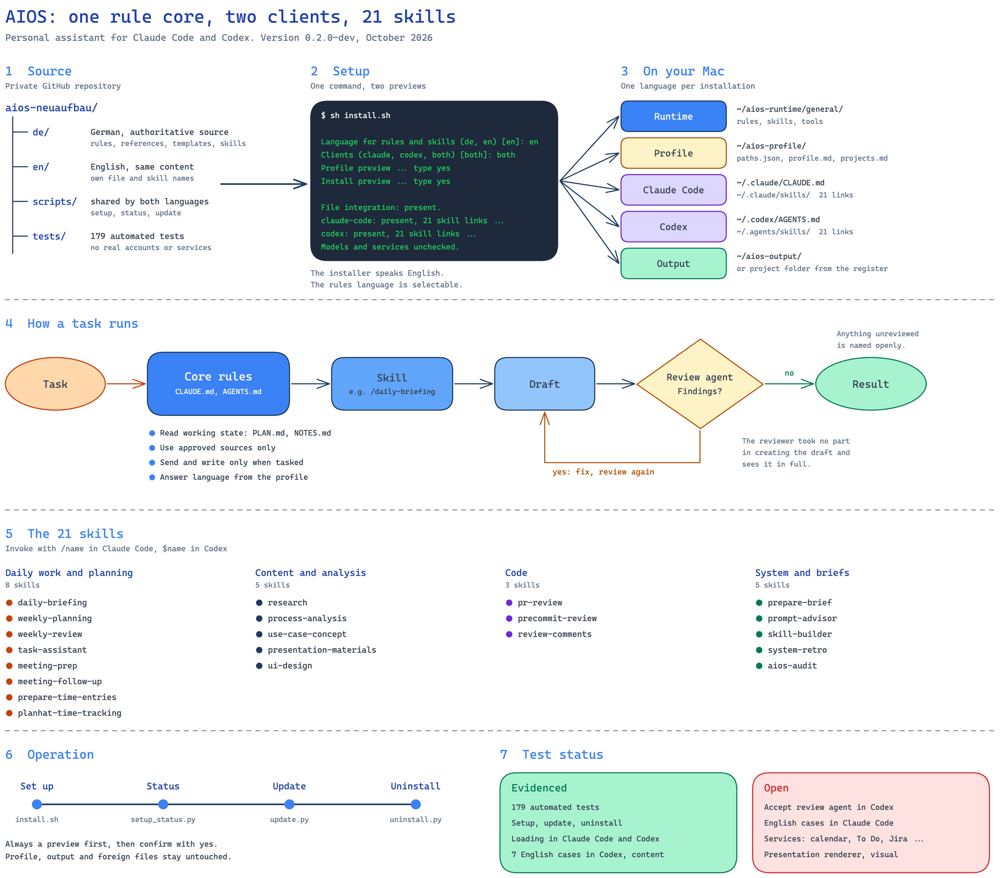

# AIOS

A personal assistant setup for Claude Code and Codex: shared core rules, 21 skills, profile templates and a guarded installer with update and targeted uninstall. The package exists in two languages. An installation uses exactly one of them.

| Folder | Language | Installed under |
| --- | --- | --- |
| `en/` | English | `<runtime>/general/` |
| `de/` | German, the authoritative source | `<runtime>/allgemein/` |



The editable diagram is [docs/praesentation/aios-overview.excalidraw](docs/praesentation/aios-overview.excalidraw), the German version is [aios-uebersicht.excalidraw](docs/praesentation/aios-uebersicht.excalidraw).

The scripts in `scripts/` are shared and speak English. Personal data and credentials never go into this repository. Installed files, synthetic tests and loader checks do not prove that services, models or skills work in practice.

## Requirements

macOS with Git, Python 3 and Claude Code and/or Codex in the terminal.

## Install

```sh
git clone https://github.com/alexandergreif/aios-neuaufbau.git "$HOME/aios-neuaufbau"
cd "$HOME/aios-neuaufbau"
sh install.sh
```

The setup asks in English for:

1. Language for rules and skills (`en` or `de`, default `en`). You can also pass `--language en` or `--language de`.
2. Clients (`claude`, `codex` or `both`, default `both`).
3. Folders for source code, runtime, profile and output. Source code defaults to this checkout and must stay there. The other defaults are `~/aios-runtime`, `~/aios-profile` and `~/aios-output`.
4. Optional coding roots and customer roots, one path per line, an empty line ends the list. Keep customer roots next to coding roots, not inside them.
5. Profile details. Unanswered fields stay `open`. If you list several languages, the first one is your output language.

After you confirm the profile, the setup asks whether you want to enter an optional Blockbrain key (default `no`). Two previews are shown, one for the profile and one for the installation. Confirm each by typing `yes`. A read-only status check runs at the end and should report `present`.

The profile folder of an English installation contains `paths.json`, `profile.md`, `projects.md`, `knowledge/`, `state/` and `.env`. A German installation uses `pfade.json`, `profil.md`, `projekte.md`, `wissen/` and `zustand/`.

### Try It in an Isolated Folder First

```sh
AIOS_TEST_HOME="$(mktemp -d "$HOME/aios-test.XXXXXX")"
sh install.sh --home "$AIOS_TEST_HOME" --claude-config-dir "$AIOS_TEST_HOME/.claude"
CLAUDE_CONFIG_DIR="$AIOS_TEST_HOME/.claude" claude --setting-sources user,project
```

Choose `claude`, keep the suggested folders and use test profile details only. Inside Claude Code, `/prepare-brief Plan a one-hour learning block for Python.` is a good first check.

## Status, Update and Uninstall

Use the configuration file of your installation (`paths.json` for English, `pfade.json` for German). Without `--apply`, update and uninstall only show a preview. The status check only reads.

```sh
python3 scripts/setup_status.py --config ~/aios-profile/paths.json --home ~
python3 scripts/update.py --config ~/aios-profile/paths.json --home ~ --apply
python3 scripts/uninstall.py --config ~/aios-profile/paths.json --home ~ --apply
```

An update keeps the language of the installation. Switching languages means uninstalling and then running the setup again with a new profile folder and a runtime folder that does not exist yet. Update and uninstall only touch files the installer recorded as its own. Profile data, output and foreign files stay unchanged. Only the installation records in the state folder are updated, and an update keeps a backup of each replaced client rule file there.

## Tests

```sh
python3 -B -m unittest discover -s tests
```

### Test Status

Evidenced: 179 automated tests, setup, update and uninstall on a real Mac with 0.1.x, the English 0.2.0-dev in an isolated test home, the update of a real installation to 0.2.0-dev, native loading of the core rules and all 21 skills in Claude Code and Codex, and the content of seven English model cases in Codex.

Open: acceptance of the independent review agent in Codex, English model cases in Claude Code, connected services such as calendar, Microsoft To Do and Jira, and a visual acceptance of the presentation renderer. For a full test of the English version, follow the [English test guide](docs/english-full-test.md).

## Further Reading

- [English test guide](docs/english-full-test.md)
- [Name tables and glossary for the English version](docs/englische-fassung.md) (German)
- [Decision log and history](README.de.md) (German)
- [Current project state](.aios/PLAN.md) (German)
